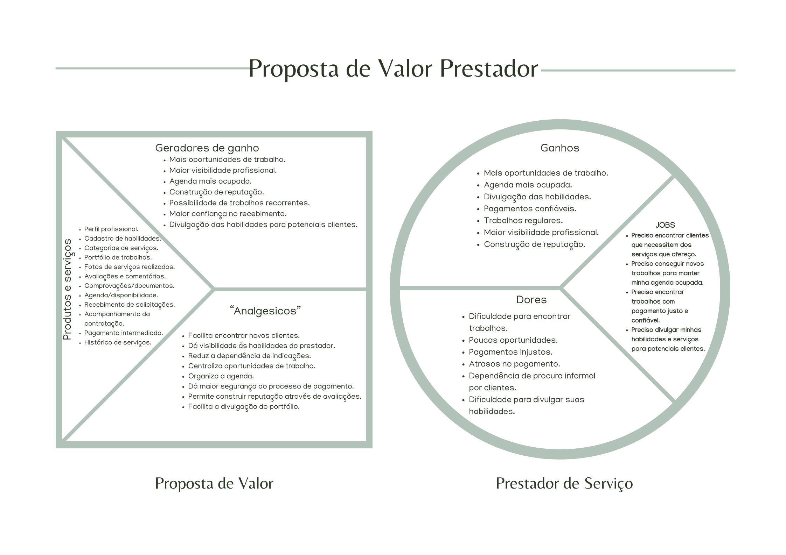
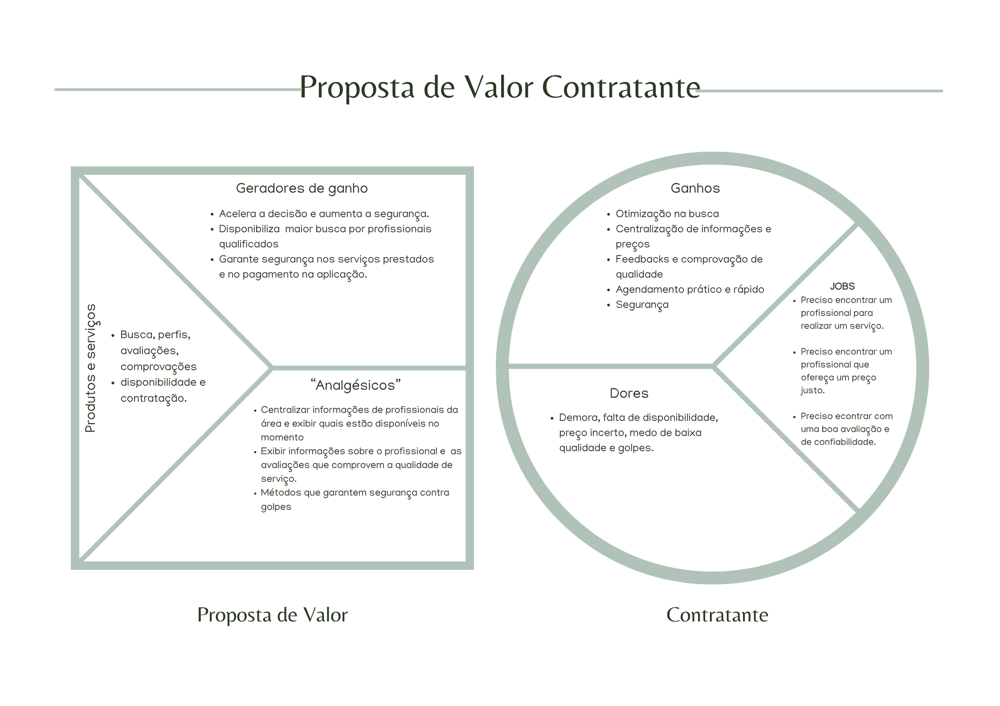
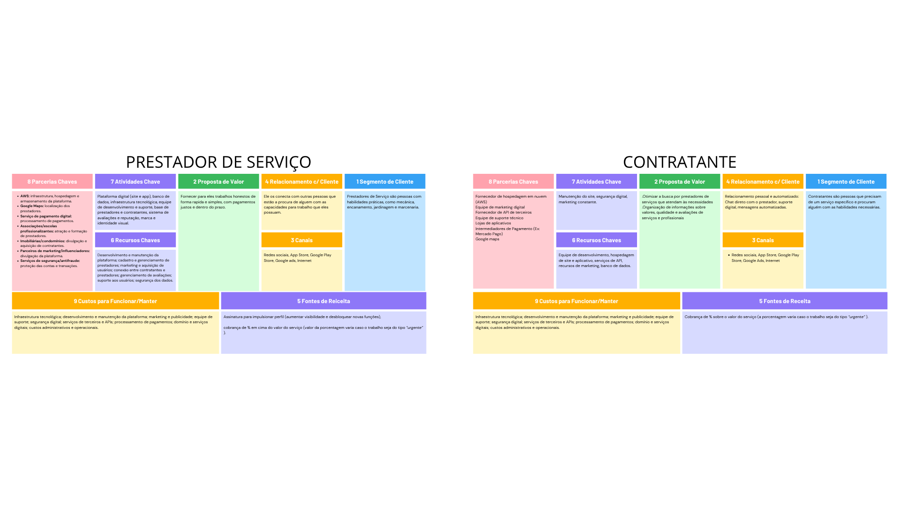
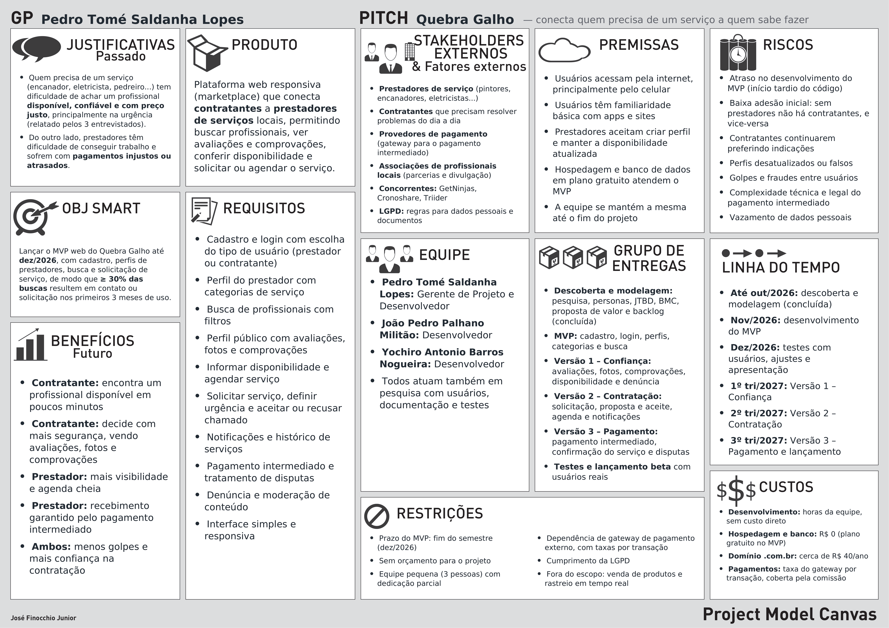

# 🔧 Quebra Galho

> Plataforma que conecta quem precisa de um serviço a quem sabe fazer.

Cano estourou? Grama alta? Reforma sem saber por onde começar? O **Quebra Galho** reúne encanadores, eletricistas, jardineiros, pedreiros, marceneiros e outros profissionais em um só lugar, para que contratar um serviço seja rápido, transparente e confiável para os dois lados.

📌 **Status:** descoberta, modelagem do negócio e planejamento do projeto concluídos. Início do desenvolvimento do MVP na pasta [`dev/`](dev/).

---

## 📖 Sumário

- [Sobre o projeto](#-sobre-o-projeto)
- [Para quem é](#-para-quem-é)
- [O que é e o que não é](#-o-que-é-e-o-que-não-é)
- [Proposta de valor](#-proposta-de-valor)
- [Modelo de negócio](#-modelo-de-negócio)
- [Concorrentes](#-concorrentes)
- [Roadmap](#-roadmap)
- [Planejamento do projeto](#-planejamento-do-projeto)
- [Progresso](#-progresso)
- [Documentação](#-documentação)
- [Estrutura do repositório](#-estrutura-do-repositório)
- [Equipe](#-equipe)

---

## 💡 Sobre o projeto

**Elevator pitch**

Para prestadores de serviço e pessoas que precisam contratar profissionais, que enfrentam dificuldades para encontrar serviços disponíveis, preços justos, qualidade comprovada e profissionais confiáveis, o **Quebra Galho** é uma plataforma digital de contratação de serviços que conecta rapidamente contratantes e prestadores, permitindo pesquisar profissionais, consultar avaliações e comprovações, verificar disponibilidade e solicitar ou agendar serviços.

Diferente de indicações, buscas dispersas na internet e plataformas concorrentes, o Quebra Galho centraliza em um único ambiente a **descoberta, reputação, disponibilidade e contratação**, tornando o processo mais rápido, transparente e confiável para os dois lados.

**Objetivos**

- Conectar oferta e demanda de serviços locais.
- Reduzir a dificuldade de encontrar profissionais disponíveis.
- Dar visibilidade às habilidades e serviços dos prestadores.
- Ajudar contratantes a avaliar qualidade, confiabilidade e preço antes de contratar.
- Centralizar o processo de contratação e pagamento.

---

## 👥 Para quem é

O Quebra Galho atende dois lados do marketplace ao mesmo tempo:

| Segmento | Quem são | Principais dores |
|---|---|---|
| **Prestadores de serviço** | Pessoas com habilidades manuais: mecânica, encanamento, jardinagem, marcenaria, pintura, entre outras | Dificuldade em achar trabalhos, poucas oportunidades, pagamentos injustos e atrasados, dependência de indicações |
| **Contratantes** | Pessoas que precisam resolver um problema específico e procuram alguém capacitado | Demora, falta de disponibilidade, preço incerto, medo de baixa qualidade e de golpes |

### Personas

| Persona | Ocupação | Dor principal | Objetivo na plataforma |
|---|---|---|---|
| **Daniela Santos** | Funcionária de lanchonete | Não consegue achar alguém para reformar sua casa | Contatar um profissional que atenda às suas necessidades |
| **Wagner Moura** | Pintor, marceneiro e gesseiro | Não consegue trabalho e, quando consegue, é mal pago | Manter a agenda cheia, com trabalhos regulares e pagamento justo |

As dores foram levantadas com formulário e entrevistas, cujo roteiro está em [Validação das dores](docs/validacao_dores.pdf). Os jobs de cada segmento estão em [Jobs to be Done](docs/jtbd.pdf).

---

## ✅ O que é e o que não é

| É | Não é |
|---|---|
| Uma plataforma que conecta prestador e contratante | Um aplicativo de encontros para relações não trabalhistas |
| Um serviço digital que agiliza a solução de problemas do dia a dia | Uma loja de produtos para casa ou material de construção |
| Um ambiente com perfis de prestadores e avaliações dos contratantes | Um canal para divulgar produtos de marcas específicas |

Detalhes, incluindo o que a plataforma faz e não faz, em [É, não é, faz e não faz](docs/e_nao_e_faz_e_nao_faz.pdf).

---

## 🎯 Proposta de valor

Um canvas de proposta de valor para cada lado do marketplace.

### Prestador de serviço

Mais oportunidades de trabalho, visibilidade profissional, reputação construída por avaliações e mais segurança no recebimento.



### Contratante

Busca otimizada, informações e preços centralizados, comprovação de qualidade, agendamento rápido e proteção contra golpes.



---

## 📊 Modelo de negócio

Business Model Canvas feito separadamente para prestadores e contratantes.



**Fontes de receita**

- **Prestadores:** assinatura para impulsionar o perfil, com mais visibilidade e funções extras.
- **Ambos os lados:** porcentagem sobre o valor do serviço, maior quando o trabalho é do tipo *urgente*.

---

## 🏁 Concorrentes

- [GetNinjas](https://www.getninjas.com.br)
- [Cronoshare](https://www.cronoshare.com.br)
- [Triider](https://www.triider.com.br)

A existência desses concorrentes mostra que o problema é reconhecido pelo mercado. O diferencial do Quebra Galho está em atacar as dores apontadas na validação: **disponibilidade, preço, comprovação de qualidade, avaliações e confiança**.

---

## 🗺️ Roadmap

| Fase | Foco | Principais entregas |
|---|---|---|
| **1. MVP de descoberta e perfis** | Criar o núcleo do marketplace | Cadastro e login, perfil de prestador, categorias, busca, perfil público |
| **2. Confiança e disponibilidade** | Reduzir o risco percebido na contratação | Avaliações, fotos de trabalhos, comprovações, disponibilidade, filtros, denúncia e moderação |
| **3. Solicitação e agendamento** | Transformar descoberta em contratação | Solicitação de serviço, proposta e aceite, agenda, notificações, histórico |
| **4. Pagamento e reputação** | Dar segurança ao fluxo completo | Pagamento intermediado, confirmação do serviço, avaliação pós-serviço, regras de disputa |
| **5. Escala e otimização** | Aumentar a densidade do marketplace | Melhorias na busca, métricas, recomendações, parcerias, monetização |

As métricas de sucesso de cada fase estão no [Roadmap estratégico](docs/roadmap_estrategico.pdf).

---

## 🧭 Planejamento do projeto

### Project Model Canvas

O planejamento do projeto foi consolidado em um Project Model Canvas, que responde em um único quadro *por que*, *o que*, *quem*, *como*, *quando* e *quanto*.



| Pergunta | Resumo |
|---|---|
| **Por quê?** | Contratantes não encontram profissionais disponíveis, confiáveis e com preço justo; prestadores não encontram trabalho e sofrem com pagamentos injustos. |
| **Objetivo SMART** | Lançar o MVP web até dez/2026, com cadastro, perfis, busca e solicitação de serviço, de modo que ≥ 30% das buscas resultem em contato ou solicitação nos primeiros 3 meses de uso. |
| **O quê?** | Plataforma web responsiva que conecta contratantes a prestadores de serviços locais. |
| **Quem?** | Prestadores, contratantes, provedores de pagamento, associações de profissionais, concorrentes e LGPD. |
| **Como?** | Entregas em MVP e três versões (Confiança, Contratação e Pagamento), com equipe de 3 pessoas e sem orçamento. |
| **Quando e quanto?** | MVP entre nov e dez/2026; versões seguintes ao longo de 2027; custo direto praticamente zero no MVP. |

Versão em PDF (A1, para impressão): [Project Model Canvas](docs/PMC_Quebra_Galho.pdf).

### Backlog de user stories

As 37 user stories foram priorizadas por valor de negócio e risco na [planilha de planejamento](<docs/PlanejamentoUserStories (1).xlsx>). As primeiras iterações do MVP são:

| Iteração | História | Pontos |
|---|---|---|
| 1 | Escolher tipo de usuário | 3 |
| 1 | Cadastrar perfil de prestador | 2 |
| 2 | Cadastrar usuário | 5 |
| 3 | Autenticar usuário | 1 |

---

## 📈 Progresso

**Descoberta e modelagem**

- [x] Ideia inicial e concorrentes
- [x] É, não é, faz e não faz
- [x] Segmentos de clientes e personas
- [x] Roteiro de validação das dores
- [x] Jobs to be Done
- [x] Problem-Solution Fit
- [x] Matriz SCD
- [x] Business Model Canvas
- [x] Canvas de Proposta de Valor (prestador e contratante)
- [x] Elevator pitch
- [x] Roadmap estratégico
- [x] Backlog de user stories priorizado
- [x] Project Model Canvas
- [ ] Mapas de empatia
- [ ] Link do formulário de validação no documento

**Desenvolvimento**

- [ ] Fase 1 do roadmap: MVP de descoberta e perfis

---

## 📂 Documentação

Os documentos ficam em [`docs/`](docs/) e as imagens dos diagramas em [`assets/`](assets/), na ordem em que foram produzidos:

| # | Documento | Descrição |
|---|---|---|
| 01 | [Ideia inicial](docs/Projeto.pdf) | Proposta original, exemplos de uso, concorrentes e ideias de nome |
| 02 | [É, não é, faz e não faz](docs/e_nao_e_faz_e_nao_faz.pdf) | Delimitação do escopo do produto |
| 03 | [Segmentos de clientes](docs/clientes.pdf) | Segmentos, dores e personas |
| 04 | [Validação das dores](docs/validacao_dores.pdf) | Formulário e roteiro de entrevistas com o público |
| 05 | [Jobs to be Done](docs/jtbd.pdf) | Jobs funcionais de prestadores e contratantes |
| 06 | [Problem-Solution Fit](docs/psf.pdf) | Consolidação do problema, da solução e das hipóteses |
| 07 | [Matriz SCD](docs/SCD.pdf) | Suposições, certezas e dúvidas |
| 08 | [Business Model Canvas](assets/busines_model_canvas.png) | Os 9 blocos do modelo de negócio, por segmento |
| 09 | Canvas de Proposta de Valor: [Prestador](assets/canvas_proposta_valor_p.png) · [Contratante](assets/canvas_proposta_valor_c.png) | Perfil do cliente e mapa de valor |
| 10 | [Elevator pitch](docs/elevator_pitch.pdf) | Estrutura e texto do pitch |
| 11 | [Roadmap estratégico](docs/roadmap_estrategico.pdf) | Fases do produto e métricas sugeridas |
| 12 | [Planejamento de user stories](<docs/PlanejamentoUserStories (1).xlsx>) | Backlog priorizado por valor e risco, com iterações |
| 13 | [Project Model Canvas](docs/PMC_Quebra_Galho.pdf) · [imagem](assets/project_model_canvas.png) | Planejamento do projeto em um único quadro |

---

## 🗂️ Estrutura do repositório

```
2026_2_PA1/
├── assets/   ← imagens dos diagramas (canvas e PMC)
├── dev/      ← código do MVP
├── docs/     ← documentos do projeto (PDF e planilha)
└── README.md
```

---

## 🧑‍💻 Equipe

| Nome | GitHub |
|---|---|
| João Pedro Palhano Militão | [@yyRed-dev](https://github.com/yyRed-dev) |
| Pedro Tomé Saldanha Lopes | [@pedr0tm](https://github.com/pedr0tm) |
| Yochiro Antonio Barros Nogueira | [@yochirokbn](https://github.com/yochirokbn) |

---

<sub>Projeto desenvolvido na disciplina PA1 · 2026.2</sub>
